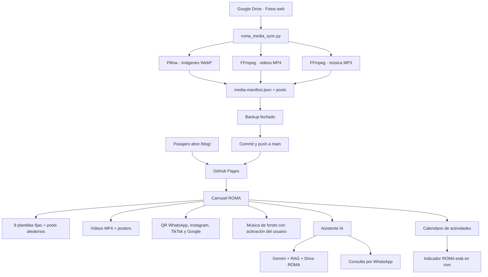

# Flujo completo de la página ROMA

La página pública es estática y se publica en GitHub Pages. Google Drive funciona como biblioteca de contenidos; el servidor sincroniza los archivos cada 15 minutos y publica copias web optimizadas.



## Secuencia de sincronización

1. Se sube una imagen, video o pista de música a `Fotos web`.
2. El temporizador del servidor ejecuta el sincronizador cada 15 minutos.
3. Se consultan únicamente archivos nuevos o modificados.
4. Las imágenes se convierten a WebP y los videos a MP4 H.264 con poster JPG, dentro de un lienzo 1920×1080. Los archivos cuyo nombre termina en `01` se excluyen del carrusel como borradores o duplicados.
5. La música se convierte a MP3 liviano y queda disponible para reproducción en loop.
6. Se actualizan `media-manifest.json` y `slides.json`. `slides.json` conserva nueve plantillas: 1/4/5 usan el pool de regiones (`Valles`, `Quebrada`, `Puna`, `Yungas`), 2 usa `Alojamiento`, 3 exclusivamente `Traslados`, 7 `Actividades`, 8 `Opinion` y 9 `Despedida`.
7. Se crea un backup con fecha y hora fuera del repositorio.
8. Se genera un commit y se publica en `main`.
9. GitHub Pages reconstruye la página.

## Componentes de la página

| Componente | Fuente | Función |
| --- | --- | --- |
| Carrusel | `slides.json` + `media-manifest.json` | Conserva nueve plantillas y selecciona aleatoriamente medios de cada pool sin crear diapositivas adicionales. |
| Imágenes | Drive → WebP | Paisajes, alojamiento, traslados y actividades. |
| Videos | Drive → MP4 + poster | Reproducción silenciosa compatible con TV y tablet. |
| Música | Drive → MP3 | Inicio automático en silencio y activación del sonido con el primer toque o el botón `Activar música`; luego continúa en loop. |
| QR | SVG locales | WhatsApp, Instagram, TikTok y reseñas Google. |
| Asistente IA | Servicio ROMA | Consultas multilingües y derivación a WhatsApp. |
| Calendario | Google Calendar | Actividades y aviso de transmisiones en vivo. |

## Rollback

Cada sincronización conserva un archivo en:

```text
~/roma-backups/media-sync/AAAAMMDDTHHMMSS-0300-XXXXXX/
```

Para recuperar el estado anterior se restaura el archivo `antes-media-sync.tar.gz` y se publica mediante un commit normal. No se utiliza `git push --force`.
