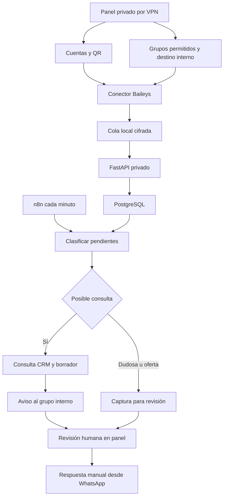

# WhatsApp en ROMA: despliegue del piloto

Este módulo suma al CRM existente cuentas vinculadas por QR, selección de grupos, captura de texto, clasificación local y avisos al grupo interno. Usa un conector no oficial (Baileys): puede desconectarse o dejar de funcionar ante cambios de WhatsApp. No modifica el número ni migra la aplicación a Cloud API. Comenzar con una cuenta y dos grupos de prueba.

## Flujo y alcance



- Hasta 10 cuentas en este piloto. Cada grupo fuente tiene una sola cuenta recolectora.
- Solo grupos donde esa cuenta participa, seleccionados explícitamente en el panel. Un grupo interno receptor nunca puede ser una fuente, tampoco para otra cuenta.
- Solo mensajes nuevos de texto, recibidos como `notify`, con antigüedad máxima de una hora. Se excluyen mensajes propios, chats privados, historial, imágenes, audio, mensajes temporales y de una sola visualización. No hay recuperación garantizada de mensajes durante desconexiones.
- Las reglas detectan algunas expresiones de demanda; pueden equivocarse. Lo dudoso y las ofertas permanecen en Capturas; las posibles consultas generan un código CON y una plantilla. La plantilla puede repetir datos ya informados. No usa Gemini ni consume tokens en esta etapa.
- Cada mensaje se trata por separado; aún no se agrupan conversaciones. La migración 003 agrega extracción de pasajeros/fechas y ficha editable (ver actualización al final).
- El panel muestra las últimas 100 capturas. No hay borrado automático: los originales y la auditoría se conservan; revisar retención y espacio antes de ampliar el piloto.
- Con la migración 003 el borrador se guarda en la ficha y puede abrirse en WhatsApp para envío manual. No existe envío automatizado al pasajero ni al grupo fuente.
- El aviso interno incluye un extracto de la consulta y el borrador inicial; el original completo queda en el panel.

## 1. Respaldo y actualización en la VM

Ejecutar desde la sesión SSH habitual de `shifuleinad`. No pegar aquí archivos `.env`, claves, QR ni datos de sesión.

```bash
cd ~/roma-asistente-web/server
sudo bash backup_crm.sh
cd ..
git status --short
git pull --ff-only
cd server
python3 setup_whatsapp.py
```

Si hay archivos de código modificados localmente o `git pull` falla, conservarlos y resolver el conflicto antes de seguir; no hacer reset. El generador preserva `.env.whatsapp` si ya existe. Crea `WA_BRIDGE_TOKEN` y `WA_SESSION_KEY` con permisos 600; conservarlos en respaldo privado, fuera de GitHub. La clave de sesiones es necesaria para volver a abrir la cola y las sesiones cifradas.

## 2. Construcción y arranque

```bash
sudo docker compose --env-file .env.crm -f compose.yaml -f compose.crm.yaml -f compose.whatsapp.yaml config --quiet
sudo docker compose --env-file .env.crm -f compose.yaml -f compose.crm.yaml -f compose.whatsapp.yaml up -d --build
sudo docker compose --env-file .env.crm -f compose.yaml -f compose.crm.yaml -f compose.whatsapp.yaml ps
sudo docker compose --env-file .env.crm -f compose.yaml -f compose.crm.yaml -f compose.whatsapp.yaml exec -T assistant python -m crm.smoke
sudo docker compose --env-file .env.crm -f compose.yaml -f compose.crm.yaml -f compose.whatsapp.yaml exec -T wa-bridge node -e "fetch('http://127.0.0.1:3000/health').then(r=>r.json()).then(console.log)"
```

Se aplican las migraciones pendientes sin reemplazar las tablas existentes. El diagnóstico debe indicar `schema_migrations: 4`, PostgreSQL OK y `{ ok: true }` para el conector. **Health comprueba el proceso; no significa que una cuenta de WhatsApp esté vinculada.**

En los próximos `up` y reconstrucciones del CRM, incluir siempre los tres archivos Compose. `wa-bridge` no publica puertos; la administración se realiza a través del panel privado existente. No apuntar Cloudflare Tunnel al panel ni al conector. Si el importador Drive está activo con un perfil, conservar también su opción `--profile drive-import` en los despliegues que lo incluyan.

## 3. Vincular una cuenta: intervención en el teléfono

1. Con la VPN conectada, abrir el panel habitual, normalmente `http://172.27.91.193:8011/whatsapp`, con el usuario y contraseña existentes. Si el panel usa otra IP privada, conservar esa dirección.
2. Agregar una cuenta con un nombre reconocible. Pulsar **Conectar**.
3. En ese teléfono: WhatsApp → Dispositivos vinculados → Vincular un dispositivo. Escanear el QR del panel. No compartir el QR.
4. Esperar el estado `conectada`. Pulsar **Cargar grupos**.
5. Elegir un grupo de prueba como fuente y otro grupo interno como receptor. Guardar. La cuenta debe pertenecer a ambos y poder enviar en el receptor.

Guardar el destino interno configura dónde se enviarán los avisos cuando se pulse el botón de envío o se active n8n. No se realiza una campaña ni se contacta a pasajeros.

Alternativa si el panel solo escucha en localhost: desde la computadora personal, `ssh -L 8011:127.0.0.1:8011 shifuleinad@172.27.91.193` y abrir `http://127.0.0.1:8011/whatsapp` mientras esa sesión permanece abierta.

## 4. Prueba de punta a punta, antes de automatizar

Desde **otro número**, escribir en el grupo fuente seleccionado:

> Necesito un transfer desde el aeropuerto para cuatro personas el viernes.

Esperar unos segundos y en el panel:

1. **Actualizar capturas**: debe aparecer el mensaje original.
2. **Clasificar pendientes**: debe aparecer un código CON, categoría transfer y borrador. La consulta también aparece en Gestión comercial.
3. **Enviar avisos internos pendientes**: debe llegar un único aviso al grupo receptor.
4. Repetir los botones: el mismo evento no debe generar otra consulta ni otro aviso.
5. Confirmar que no se publicó nada en el grupo fuente. Revisar el borrador y responder manualmente cuando corresponda.

La deduplicación usa cuenta, grupo, autor e ID del mensaje; un mensaje nuevo con el mismo texto es otro evento. `sent` significa que WhatsApp aceptó el envío, no que alguien lo leyó. `unknown` significa resultado incierto: revisar el grupo interno manualmente, no se reintenta automáticamente. `pending` se reintenta; `paused` indica fuente retirada y no se reanuda por sí solo.

## 5. Conectar n8n a la red privada de Docker

Primero identificar los nombres reales:

```bash
sudo docker ps --format 'table {{.Names}}\t{{.Status}}'
sudo docker network ls
```

Con los nombres habituales de este servidor, si todavía no está conectado:

```bash
sudo docker network connect roma-assistant_default n8n-docker-n8n-1
```

Si devuelve que ya existe el endpoint, ya está conectado. No cambiar la red predeterminada de n8n: necesita seguir llegando a su propia base de datos. Esta conexión manual se pierde al recrear su contenedor; para hacerla persistente, agregar al Compose **de n8n**, adaptando el nombre real de su servicio:

```yaml
services:
  n8n:
    networks:
      - default
      - roma_crm
networks:
  roma_crm:
    external: true
    name: roma-assistant_default
```

Si n8n ya declara otras redes, conservarlas y agregar `roma_crm` a esa lista. Aplicar el cambio desde su propio directorio Compose. No exponer PostgreSQL ni agregar puertos al conector.

## 6. Importar y activar el workflow

Importar en n8n el archivo `server/n8n/roma-whatsapp-pilot.json`, desde archivo o desde su URL raw de GitHub. Se entrega **inactivo**.

En el nodo **Clasificar y avisar al grupo interno**, crear una credencial **Header Auth**:

- Name: `Authorization`
- Value: `Bearer ` seguido del valor de `CRM_AUTOMATION_TOKEN` ya existente en `.env.crm`.

Leer ese valor localmente con `nano .env.crm`; no enviarlo por chat ni incluirlo en el JSON del workflow. No utilizar la contraseña del panel ni `WA_BRIDGE_TOKEN` como credencial de n8n.

Ejecutar manualmente una vez y comprobar el resultado. El endpoint devuelve solo contadores y estados. Después activar/publicar el workflow según la versión de n8n. Cada minuto procesa hasta 20 mensajes, hasta 3 avisos iniciales y hasta 2 avisos de formularios recibidos. Un bloqueo en PostgreSQL impide despachadores simultáneos y un registro durable en el conector evita reenvíos del mismo evento.

El workflow de prueba anterior `roma-crm-events.json` es independiente: no sustituye esta automatización. Esta etapa no necesita un webhook público, bibliotecas de scraping ni un modelo de IA.

## 7. Operación y respaldo

- **Pausar** detiene esa cuenta. Para detener avisos programados, desactivar también el workflow. Los avisos pendientes permanecen guardados.
- **Desvincular** intenta cerrar la sesión remota y borra sus claves locales; comprobar también Dispositivos vinculados en el teléfono. Si falla la revocación, eliminar allí el dispositivo. Se conservan configuración, capturas y auditoría.
- `requiere_revision`: revisar el teléfono, desvincular y escanear un nuevo QR. No crear cuentas repetidas para eludir fallos de conexión.
- El respaldo `backup_crm.sh` incluye consultas y capturas en PostgreSQL, **no las sesiones del conector**. Para respaldarlas sin inconsistencias, detener `wa-bridge`, copiar el directorio `/data` y volver a iniciarlo. Guardar también `.env.whatsapp` en un lugar privado separado. La copia contiene claves cifradas y mensajes; restringir acceso.

Ejemplo de copia local con el contenedor detenido:

```bash
cd ~/roma-asistente-web/server
sudo docker compose --env-file .env.crm -f compose.yaml -f compose.crm.yaml -f compose.whatsapp.yaml stop wa-bridge
sudo install -d -m 700 backups/whatsapp
sudo docker compose --env-file .env.crm -f compose.yaml -f compose.crm.yaml -f compose.whatsapp.yaml cp wa-bridge:/data/. backups/whatsapp/
sudo chmod -R go-rwx backups/whatsapp
sudo docker compose --env-file .env.crm -f compose.yaml -f compose.crm.yaml -f compose.whatsapp.yaml start wa-bridge
```

Ese destino se reutiliza; para conservar varias generaciones usar un directorio nuevo con fecha por respaldo. No ejecutar dos conectores simultáneos con la misma sesión restaurada. La restauración debe mantener juntas base SQLite, archivos WAL si existen y clave original.

Diagnóstico sin imprimir sesiones ni mensajes:

```bash
sudo docker compose --env-file .env.crm -f compose.yaml -f compose.crm.yaml -f compose.whatsapp.yaml ps
sudo docker compose --env-file .env.crm -f compose.yaml -f compose.crm.yaml -f compose.whatsapp.yaml logs --tail=40 wa-bridge crm-migrate
```

## Criterio para ampliar el piloto

Vinculación estable, captura desde un segundo número, oportunidad visible, aviso interno único y revisión humana completada. Después incorporar más cuentas y grupos desde el panel. Evaluación por IA con catálogo aprobado, agrupación de mensajes, aprobación formal de presupuestos, clasificación de audio y métricas por cuenta son fases posteriores.

## Actualización: ficha comercial y contacto (migración 003)

Las nuevas consultas incluyen una ficha editable, borrador persistente y botón verde para abrir WhatsApp con el texto guardado. El workflow de n8n existente sigue siendo válido y no necesita nuevos nodos ni credenciales.

### Actualizar la VM

Desactivar temporalmente el workflow programado de n8n mientras se reconstruyen los servicios. Desde `~/roma-asistente-web/server`, crear respaldo con `sudo bash backup_crm.sh`. Luego:

```bash
cd ~/roma-asistente-web
# Si hay cambios locales, conservarlos y resolverlos antes de actualizar.
git status --short
git pull --ff-only
cd server
sudo docker compose --env-file .env.crm -f compose.yaml -f compose.crm.yaml -f compose.whatsapp.yaml up -d --build
sudo docker compose --env-file .env.crm -f compose.yaml -f compose.crm.yaml -f compose.whatsapp.yaml exec -T assistant python -m crm.smoke
```

El diagnóstico debe mostrar `schema_migrations: 3`. Reactivar n8n al terminar y recargar el panel. Las sesiones existentes se conservan en su volumen; no regenerar `.env.whatsapp`.

### Uso

1. Abrir **Ficha, datos faltantes y respuesta** debajo de una consulta CON.
2. Revisar nombre y teléfono. El conector obtiene el número cuando llega como identificador telefónico, como identificador alternativo del autor o mediante una correspondencia LID disponible. Un LID nunca se convierte directamente en teléfono. El nombre mostrado no verifica la identidad de la persona.
3. Revisar pasajeros, origen, destino, fechas propuestas, horario/vuelo y equipaje. Completar actividad o fecha final según el servicio. La fecha relativa se calcula respecto del mensaje, en `America/Argentina/Jujuy`, y necesita confirmación antes de pasar a las fechas del CRM.
4. Completar **Otra duda para consultar al pasajero** si falta un dato especial, por ejemplo silla infantil, movilidad reducida o punto exacto de encuentro.
5. Pulsar **Preparar pregunta con datos faltantes** para actualizar el borrador. Los datos presentes no vuelven a preguntarse, salvo las fechas propuestas aún sin confirmar. Revisar el texto.
6. Confirmar el teléfono del destinatario y pulsar **Guardar ficha y borrador**. El botón verde se habilita solo con teléfono revisado y cambios guardados.
7. Pulsar **Abrir WhatsApp con respuesta**. Se abre `wa.me` con el texto preparado; el operador revisa el destinatario y pulsa Enviar en WhatsApp. Abrir el enlace no registra una venta ni marca automáticamente la consulta como contactada.

Si el teléfono no está disponible, completar manualmente un número internacional con `+` cuando se conozca, o copiar el borrador para responder desde el grupo. No se deduce Instagram a partir del teléfono.

Las consultas anteriores siguen disponibles. Usar **Extraer del mensaje original** para preparar su ficha y guardar. Los mensajes anteriores al despliegue pueden no contener nombre/teléfono; la extracción no recupera información que nunca se capturó.

### Alcance de la extracción

Esta versión usa reglas locales en español y no consume tokens de IA: cantidades explícitas, números escritos del uno al veinte, `somos N`, suma de adultos y menores cuando ambos están indicados; fechas `DD/MM[/AAAA]`, rangos `del DD/MM al DD/MM`, días de la semana, hoy/mañana/pasado mañana; trayectos explícitos `desde X a/hasta/hacia Y` o `transfer de X a Y`; horarios `a las HH:MM` y números de vuelo. Casos ambiguos quedan para revisión. No es un extractor general de lenguaje ni consulta tarifas/disponibilidad.

Nombre, contacto y pasajeros se reflejan en Gestión comercial. Las fechas pasan al CRM solo cuando se marcan confirmadas. El resto de la ficha y su borrador permanecen en la captura asociada al código CON. Guardar detecta cambios simultáneos tanto en la ficha como en Gestión comercial y pide actualizar antes de sobrescribir.

El aviso interno conserva su contenido original para mantener la deduplicación. Las ediciones posteriores se consultan en el panel y no generan otro aviso. Los avisos nuevos incluyen nombre y teléfono disponibles y el borrador basado en los datos extraídos. Las respuestas posteriores del pasajero aún no se fusionan automáticamente con esta ficha: completarlas manualmente.

## Actualización: formulario para el pasajero y filtros (migración 004)

### Qué cambia

El botón **Solicitar datos al pasajero** aparece visible en cada consulta CON, fuera de la ficha desplegable. Genera un formulario individual alojado en `https://asistente.romanomad.travel/solicitud` con token en el fragmento `#` del enlace. El pasajero no necesita VPN ni acceso al panel.

El formulario muestra solo datos del viaje/contacto y la duda adicional que el operador haya guardado: nunca muestra el grupo, mensaje original, notas internas, identificadores del conector ni otras consultas. No carga recursos de terceros. Cada enlace vence en 7 días; generar uno nuevo anula el anterior. La base almacena un hash del token, no el token original. No se puede recuperar el enlace después de recargar el panel: copiar el mensaje al crearlo o regenerarlo. Quien recibe el enlace puede abrir esa solicitud; compartirlo solo con su destinatario.

### Instalar

Pausar temporalmente el workflow ROMA de n8n. Ejecutar `sudo bash backup_crm.sh` desde `~/roma-asistente-web/server`; luego `git pull --ff-only` desde el repositorio y volver a `server`:

```bash
sudo docker compose --env-file .env.crm -f compose.yaml -f compose.crm.yaml -f compose.whatsapp.yaml up -d --build
sudo docker compose --env-file .env.crm -f compose.yaml -f compose.crm.yaml -f compose.whatsapp.yaml exec -T assistant python -m crm.smoke
curl --fail --max-time 30 https://asistente.romanomad.travel/solicitud -o /dev/null -w 'Formulario público: HTTP %{http_code}\n'
```

Esperar `schema_migrations: 4`, PostgreSQL OK y HTTP 200. No hace falta cambiar el túnel si ese dominio ya dirige todas las rutas al servicio `assistant`. El panel CRM continúa privado. Si usás otro dominio público para el asistente, configurar `CRM_PUBLIC_BASE_URL=https://dominio-del-asistente` en `.env.crm` (solo origen HTTPS, sin ruta) y recrear los servicios. El valor debe ser el mismo para `assistant` y `crm-admin`.

Reactivar n8n. El workflow existente no requiere reimportación: `/automation/whatsapp/run` ahora devuelve además `form_results`, los estados de avisos de formularios recibidos. Por ejecución clasifica hasta 20 capturas y despacha hasta 3 avisos iniciales y 2 respuestas de formularios. No envía formularios automáticamente a los pasajeros.

### Recorrido del operador y pasajero

1. En **Consultas con ficha**, buscar por código CON si hace falta. Si una consulta antigua no tiene ficha, extraer los datos y guardar.
2. Revisar los campos precargados y escribir **Otra duda para consultar al pasajero**. Guardar la ficha antes de generar el formulario.
3. Pulsar **Solicitar datos al pasajero**. Copiar el mensaje con enlace o usar **Compartir formulario por WhatsApp** si el teléfono está revisado. El operador pulsa Enviar en WhatsApp.
4. El pasajero abre el enlace, revisa los valores, completa los campos y acepta el uso de sus datos para esta cotización. Nombre y pasajeros son obligatorios; si no conoce una fecha/detalle, puede dejarlo pendiente y explicarlo en observaciones. No es una reserva.
5. El servidor guarda la respuesta sin sobrescribir todavía la ficha ni modificar precios. Se ve **Datos recibidos · revisar**, tanto en WhatsApp como en Gestión comercial. n8n envía un aviso interno, sin el enlace privado, para revisarla.
6. Abrir **Ver datos enviados por el pasajero**, revisar también las observaciones y pulsar **Revisé los datos: aplicar a la ficha**. Esto aplica los campos, guarda un nuevo borrador y deja la solicitud como **Datos revisados**. Verificar todavía tarifa, disponibilidad y cualquier dato faltante antes de cotizar. El teléfono vuelve a requerir revisión antes de abrir WhatsApp.
7. Si hace falta una aclaración adicional, editar la duda, guardar y crear otra solicitud después de revisar la anterior.

El mismo formulario se envía una sola vez. Reintentar por un corte de conexión usa el mismo identificador y no duplica la respuesta. Tras enviarlo, el enlace solo muestra confirmación; para corregir datos hay que contactar a ROMA y solicitar otro enlace. Una respuesta recibida debe revisarse antes de generar otro formulario, para no perderla. Las ediciones simultáneas se detectan y piden actualizar.

Los avisos internos usan una clave de entrega distinta para cada formulario y conservan el mecanismo de deduplicación. `unknown` requiere comprobación manual; no hay reenvíos automáticos de resultado incierto. Para notificar, la cuenta debe seguir conectada y mantener el grupo fuente habilitado y su destino interno.

### Filtrado con mayor volumen

- La consulta debe combinar intención de preguntar con contexto turístico. Ejemplos: “alguien sabe dónde alojarse”, “cuánto alquilan una camioneta”, “dónde alquilan cabañas”, “cómo llego a Purmamarca”.
- “Alguien sabe” o “cuánto cobran” solos no bastan. Un mensaje sobre psicólogos o alquiler de herramientas queda para revisión y no genera una oportunidad automáticamente.
- Ofertas de prestadores y mensajes sin señales de consulta se separan. Nada se elimina automáticamente.
- El panel abre en **Consultas con ficha**, permite filtrar **Datos recibidos**, **Pendientes**, **Dudosos**, **Ofertas**, **Sin señales** o **Todas**, y pagina de 50 en 50.
- En una captura sin código CON, **Es una consulta turística: crear ficha** permite recuperar manualmente un falso negativo. Puede quedar en la cola si hay más de 20 mensajes pendientes.
- El filtro nuevo se aplica a capturas aún no procesadas. No elimina ni reclasifica oportunidades ya creadas. Sigue usando reglas locales, sin tokens de IA; revisar periódicamente los casos dudosos.

Los datos recibidos y formularios se incluyen en el respaldo PostgreSQL existente. No hay eliminación automática de respuestas: establecer una política de retención antes de ampliar mucho el volumen. El límite público es de 120 solicitudes por minuto por proceso, pensado para el despliegue actual de un worker; para varias réplicas habrá que compartir ese control.
